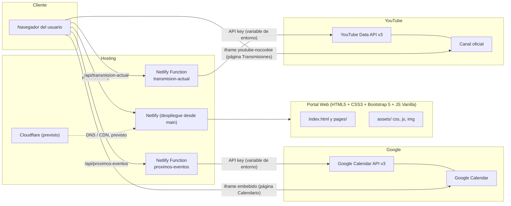

# Arquitectura General

| Campo | Valor |
|---|---|
| Documento | 03_Arquitectura/Arquitectura_General.md |
| Versión | 1.2 |
| Fecha de creación | 2026-08-05 |
| Última actualización | 2026-10-14 |
| Estado | Vigente (arquitectura implementada; ver [Estructura_Proyecto.md](Estructura_Proyecto.md) para el estado de cada carpeta) |
| Fuente | [CLAUDE.md](../../CLAUDE.md), secciones 6, 7, 11, 20 |

---

## 1. Objetivo del documento

Describir la arquitectura general del portal web: su naturaleza, componentes tecnológicos y cómo se relacionan entre sí.

## 2. Naturaleza del sistema

El portal web es un **sitio estático multipágina**, sin framework de aplicación y sin proceso de build (no existe `package.json` en el repositorio a la fecha). Se construye con HTML5, CSS3, Bootstrap 5 y JavaScript Vanilla, y se sirve directamente como archivos estáticos desde Netlify.

Tiene **una excepción deliberada y autorizada** que comprende **dos Netlify Functions** (serverless): una consulta Google Calendar API v3 para alimentar la sección «Próximos eventos» de Inicio y otra consulta YouTube Data API v3 para la página Transmisiones, de modo que ninguna API key llegue al navegador ni al repositorio público. Son los únicos componentes de servidor del portal; no existe base de datos ni otra API propia. Cualquier otra necesidad de este tipo debe ser evaluada y autorizada explícitamente, ya que CLAUDE.md restringe las tecnologías backend (sección 6): esta excepción no constituye una autorización general. Detalle y justificación en [Integracion_Google_Calendar.md](Integracion_Google_Calendar.md) e [Integracion_YouTube.md](Integracion_YouTube.md).

## 3. Diagrama de arquitectura (estado actual)

> Netlify aloja el sitio y lo despliega automáticamente desde la rama `main` (URL temporal `.netlify.app`; ver [07_Despliegue](../07_Despliegue/Netlify.md)). Cloudflare y el dominio personalizado siguen **previstos**, no configurados. Las carpetas `components/`, `config/`, `data/` y `scripts/` existen pero están vacías (ver [Estructura_Proyecto.md](Estructura_Proyecto.md)). Las integraciones con Google Calendar y YouTube se documentan en [Integracion_Google_Calendar.md](Integracion_Google_Calendar.md) e [Integracion_YouTube.md](Integracion_YouTube.md).

## 4. Principios arquitectónicos

- **Mobile First:** todo el diseño se construye primero para móvil y se escala hacia pantallas mayores (CLAUDE.md sección 7).
- **Bootstrap como base:** Bootstrap 5 es el framework principal; el CSS personalizado complementa, no sobrescribe innecesariamente (sección 7 y 9).
- **HTML5 semántico:** uso de etiquetas semánticas (`header`, `main`, `footer`, `section`, `article`, `aside`, `nav`, etc.) en lugar de `div` genéricos (sección 8).
- **Separación de responsabilidades:** `assets/` para recursos estáticos, `components/` para piezas de interfaz reutilizables, `pages/` para páginas del sitio, `data/` para datos, `config/` para configuración, `scripts/` para utilidades.
- **Sin frameworks de aplicación:** no se introducen frameworks JS de componentes ni backends de servidor de aplicaciones. Las dos Netlify Functions (Google Calendar y YouTube) son una excepción puntual autorizada (sección 2), no un backend de aplicación.

## 5. Estado actual de implementación

| Elemento | Estado |
|---|---|
| `index.html` | Página de Inicio implementada |
| `pages/` | `parroquia.html`, `grupos.html`, `calendario.html` y `transmisiones.html` implementadas |
| `assets/css` | `variables.css`, `main.css`, `components.css`, `home.css`, `parroquia.css`, `grupos.css`, `calendario.css` y `transmisiones.css` |
| `assets/js` | `grupos.js`, `proximos-eventos.js` y `transmisiones.js` |
| `netlify/functions/` | `proximos-eventos.mjs` (Netlify Function de Google Calendar) y `transmision-actual.mjs` (Netlify Function de YouTube) |
| `components/`, `config/`, `data/`, `scripts/` | Carpetas creadas, vacías |
| Hosting | Netlify conectado, despliegue automático desde `main`, URL temporal `.netlify.app` |
| Dominio / Cloudflare | No configurados |
| Integraciones activas | Google Calendar, YouTube y Netlify (ver [Integraciones.md](Integraciones.md)) |

## 6. Fuera de alcance actual

Este documento no define estructura de datos ni funcionalidades más allá de lo implementado. Las integraciones externas activas de datos (Google Calendar y YouTube) se documentan en [Integracion_Google_Calendar.md](Integracion_Google_Calendar.md) e [Integracion_YouTube.md](Integracion_YouTube.md); el alcance funcional definitivo sigue sujeto a validación con la parroquia (ver [Alcance.md](../01_Gestion_Proyecto/Alcance.md)).

---

## Documentos relacionados

- [Estructura_Proyecto.md](Estructura_Proyecto.md)
- [Integraciones.md](Integraciones.md)
- [Integracion_Google_Calendar.md](Integracion_Google_Calendar.md)
- [Integracion_YouTube.md](Integracion_YouTube.md)
- [Manual_Tecnico.md](../08_Manuales/Manual_Tecnico.md)
